# Data Model (Postgres + Prisma)

```mermaid
erDiagram
  User ||--o{ Conversation : owns
  Conversation ||--o{ Message : contains
  Message ||--o{ Attachment : has
  Conversation ||--o{ ResearchRun : triggers
  ResearchRun ||--o{ ResearchStep : has
  ResearchRun ||--o{ Source : gathers
  Message }o--o{ Source : cites
  User ||--o{ Account : "Auth.js"
  User ||--o{ Session : "Auth.js"
```

## Tables
**users**: id (uuid pk), email (unique), name, image, created_at, deleted_at. Auth.js adapter tables: accounts, sessions, verification_tokens.

**conversations**: id, user_id fk, title, model (enum-checked string), mode (`chat|research`), system_prompt_id null, created_at, updated_at, archived_at. Index (user_id, updated_at desc).

**messages**: id, conversation_id fk, parent_id fk null (branching for edit/regenerate), role (`user|assistant|system|tool`), content jsonb (array of blocks: text, tool_use, tool_result, citation refs), status (`streaming|complete|stopped|error`), model, input_tokens, output_tokens, stop_reason, error_code null, created_at. Index (conversation_id, created_at). GIN tsvector on extracted text for search.

**attachments**: id, message_id fk, user_id fk, filename, mime, size_bytes, sha256, storage_key (private bucket/disk path, never public), extracted_text null, status (`pending|ready|rejected`), created_at.

**research_runs**: id, conversation_id fk, user_id fk, message_id fk (resulting report), query, status (`queued|planning|searching|reading|synthesizing|complete|failed|cancelled`), plan jsonb, budget jsonb (max_searches, max_tokens, deadline), tokens_used, cost_estimate, error, created_at, started_at, finished_at.

**research_steps**: id, run_id fk, seq, kind (`plan|search|fetch|extract|synthesize`), input jsonb, status, started_at, finished_at, error.

**sources**: id, run_id fk, url, canonical_url, title, domain, snippet, content_hash, retrieved_at, fetch_status, excerpt (bounded text actually shown to model), rank. Unique (run_id, canonical_url).

**message_sources** (m:n): message_id, source_id, citation_index, quote null.

**audit_events**: id, user_id, type, ip_hash, created_at (login, delete, export, rate-limit hits).

**usage_counters**: user_id, day, input_tokens, output_tokens, research_runs.

## Rules
- All rows scoped by `user_id`; every query goes through a repository that requires it (row-level checks in code; Postgres RLS optional later — ADR-004 note).
- Deleting a conversation cascades messages, attachments (and storage objects via job), runs, sources.
- Citation integrity: assistant report may cite only `sources` rows from the same run.
- Retention: configurable; default keep until user deletes.

Open questions: Q5 (retention) · Next step: OpenAPI.
