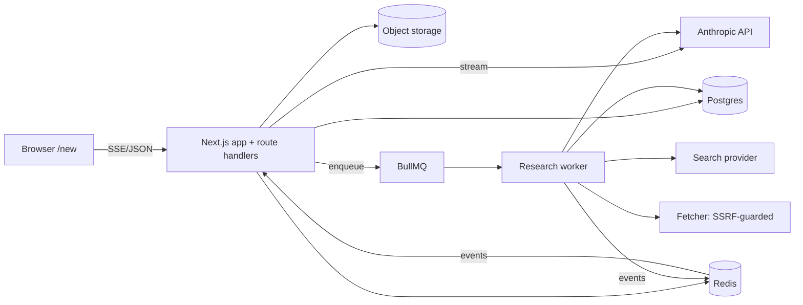

# Architecture & Stack

## Stack (default proposal; each choice has an ADR)
| Concern | Choice | Why / alternative |
|---|---|---|
| Framework | Next.js (App Router) + TypeScript | route handlers stream SSE; one repo. Alt: Vite SPA + Fastify (more moving parts) |
| UI | Tailwind + shadcn/ui (Radix) + Lucide icons | accessible primitives, own tokens; avoids copying any brand |
| DB | Postgres + Prisma | relational fit, FTS via tsvector. Prisma lacks tsvector — use `$queryRaw` for search |
| Auth | Auth.js (DB sessions) | |
| LLM | Anthropic API via official TS SDK; models `claude-fable-5-1`, `claude-opus-5-5`, `claude-sonnet-5-5`, `claude-haiku-5-5` | allow-list in config; default model Sonnet; research planner Opus/Fable, fetch-summarizer Haiku (cost) |
| Search | Provider behind `SearchProvider` interface (Brave / Tavily / Exa / SearXNG) | **needs user decision (Q4)** |
| Jobs | Redis + BullMQ worker process | long runs outside request lifecycle; resumable, cancellable |
| Storage | S3-compatible (MinIO locally) | private bucket |
| Tests | Vitest, Playwright, axe-core, Testcontainers | |
| CI | GitHub Actions: typecheck, lint, unit, e2e, gitleaks, audit | |
| Observability | pino logs, OpenTelemetry traces, Sentry (optional) | M7 |

## Component diagram


## Deep-research pipeline (our design)
1. **Plan** (Opus/Fable): decompose query → 3–8 sub-questions, JSON-schema output, validated.
2. **Search** (parallel, bounded concurrency): per sub-question 1–3 queries → provider → candidate URLs.
3. **Gather**: dedupe/canonicalize, rank, fetch (SSRF-guarded), extract main text, truncate.
4. **Read** (Haiku/Sonnet, parallel): per source, extract claims + quotes with source_id.
5. **Evaluate**: detect gaps → optional second round (budget-limited).
6. **Synthesize** (Opus/Fable): write report in markdown citing `[n]` tied to stored sources; post-check that each `[n]` exists and quotes appear in excerpt.
7. Persist report as assistant message; emit events throughout.

## Module layout (proposed, created in M0)
```
src/app/            routes (/new, /c/[id], /api/*)
src/components/     ui + chat + research
src/server/{auth,db,llm,research,search,fetcher,storage,ratelimit}/
src/lib/            shared types, zod schemas
prisma/ tests/ docs/
```

## Design tokens
Own palette/typography defined in `docs/design/tokens.md` at M0 (not yet written; to be created fresh, not derived from any product's CSS).

## ADR index (`adr/`)
001 Next.js monolith · 002 Postgres+Prisma · 003 Auth.js DB sessions · 004 Row scoping in repository layer (RLS deferred) · 005 SSE (not WebSocket) · 006 BullMQ for research · 007 SearchProvider abstraction · 008 Untrusted-content handling for agent.

Open questions: Q4, Q7 · Next step: implementation plan.
